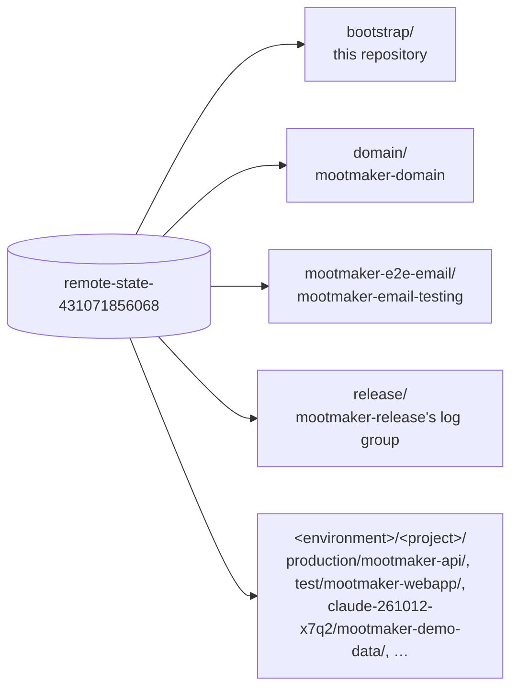

# mootmaker-bootstrap-terraform

Creates the one S3 bucket every other repository keeps its Terraform state in:
`remote-state-<account-id>` (`remote-state-431071856068`) in the workload account. Run it once per
account. Everything else here exists to make that safe.

## The bucket

| Setting | Why |
|---|---|
| `prevent_destroy` | A stray `terraform destroy` here would take every project's state with it. To decommission the bucket on purpose, remove the lifecycle block first |
| Public access blocked, AES256 encryption | State can contain resource details nobody outside the account should read |
| Versioning | A corrupted or truncated write to any project's state can be rolled back to the previous version. Without it, every resource that state tracked would be orphaned |
| Old versions expire after 30 days; empty delete markers are removed | Every ephemeral environment and release writes state several times, so unbounded versions would grow with time rather than use. 30 days is long enough to notice a bad write |
| No DynamoDB lock table | Locking uses Terraform's native S3 lockfile (`use_lockfile = true`, Terraform 1.10 or later). A second `apply` on the same key waits or fails until the first finishes |

## How the state is laid out



Each repository's `deploy/terraform/` has an empty `backend "s3" {}` block in `versions.tf` and a committed
`backend.hcl` with the bucket, region and `use_lockfile`. It is not secret. A per-environment repository's
`deploy.sh` adds the key at init time:

```bash
terraform init -backend-config=backend.hcl -backend-config="key=<environment>/<project>/terraform.tfstate"
```

A one-deployment repository (domain, email-testing, release, this one) puts a fixed `key` in its
`backend.hcl` instead. The ephemeral-environment scripts find environments by listing the first path
segment, so a fixed key that does not look like `<kind>-<YYMMDD>-<rand4>` is never mistaken for one. A
new project needs only its own `<project>` segment.

## Deploying

```bash
./deploy.sh
```

Run it deliberately, with credentials for the target account. Never run it from automation.

**The first run has to create the bucket its own state lives in.** If the bucket does not exist yet, the
S3 backend cannot initialise. `deploy.sh` handles this:

1. It tries `terraform init` against the S3 backend. If that fails, it removes the `backend "s3"` block
   for the moment and initialises with local state.
2. It applies, creating the bucket.
3. It restores the block, even if the apply failed, and initialises again with `-migrate-state`. This
   copies the local state into the bucket under `bootstrap/terraform.tfstate`.

On every later run both inits reconnect to the remote state, and `deploy.sh` behaves like any other.
After the first run a stale local `terraform.tfstate` is left behind. It is git-ignored and can be deleted.

If the bucket ever changes (a new account), update `bucket` in every repository's `backend.hcl`, then
`terraform init -reconfigure` with the same flags.
